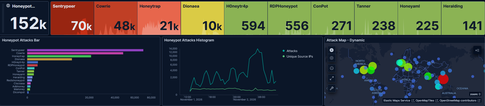
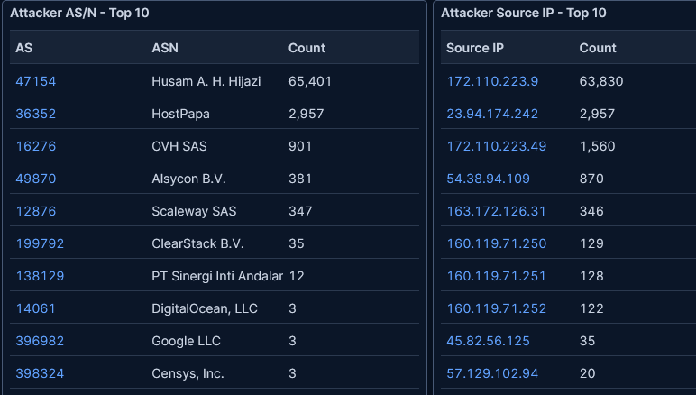
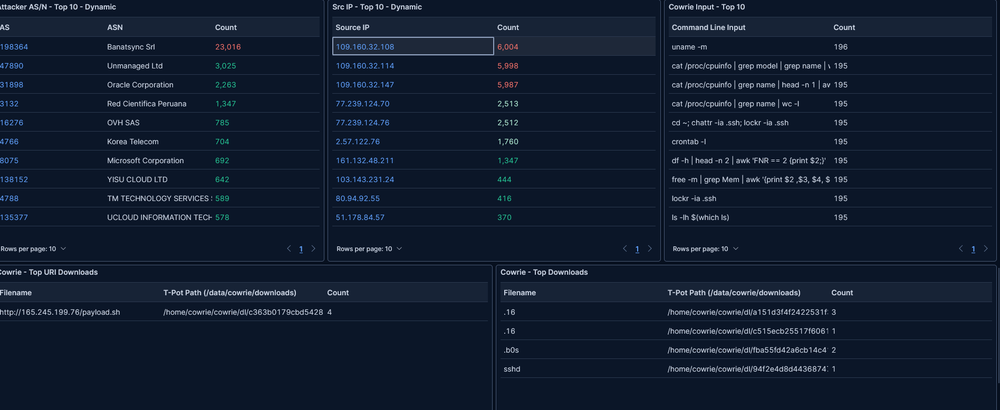
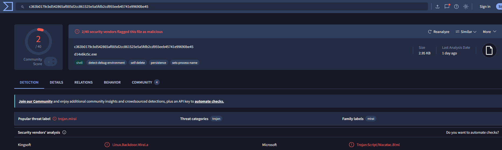
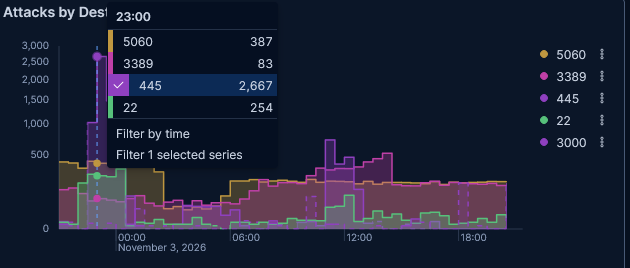
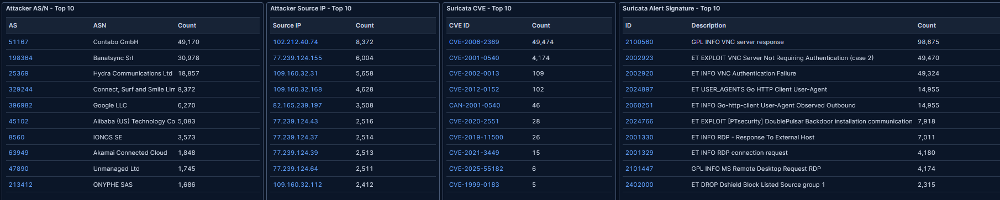

# Week 1 Threat Report (Nov 1-7, 2026)

A T-Pot honeypot on an Oracle Cloud VM, exposed to the whole internet with no domain, website or advertising. This is a summary of the first week. Details and evidence for every point are in the [findings log](findings-log.md).

## At a glance

- **First attack within minutes** of going live (243 attacks in about the first 20 minutes)
- **About 844,000 attack events** across six daily snapshots (Days 2-7, "last 24 hours" view in Kibana)
- **Busiest day:** 243K on Day 7, driven by a Windows Remote Desktop (RDP) brute-force campaign
- **2 malware samples confirmed** on VirusTotal: a crypto miner disguised as `sshd`, and a Mirai dropper that only 2 of 40 antivirus engines detected
- **15+ MITRE ATT&CK techniques** observed

## Day by day

| Day | Attacks (24h) | What drove it |
|---|---|---|
| 1 (Nov 1) | partial day | Scanning, credential stuffing with a name-based password list |
| 2 (Nov 2) | 152K | VoIP toll-fraud scanner: one IP sent 63,830 SIP requests (~40%) |
| 3 (Nov 3) | 72K | SIP campaign faded; broad port scanning, SMB and RDP bursts |
| 4 (Nov 4) | 151K | VNC campaign targeting a 20-year-old RealVNC bug (CVE-2006-2369) |
| 5 (Nov 5) | 74K | VNC campaign over; repeat SSH brute-force ranges |
| 6 (Nov 6) | 152K | RDP campaign: one IP sent 59,431 hits (39%) |
| 7 (Nov 7) | 243K | RDP campaign grew; Day 6 attackers returned at 2-4x volume |

## Top findings

**1. Most traffic comes from a handful of rented servers.** On Days 2, 6 and 7, a single IP made up 25-40% of all traffic. Almost every top source was a hosting provider (Dedires, MEVSPACE, Alsycon, Contabo, GALEON, Cherry Servers), not a home connection.

**2. Campaigns are short; operators are persistent.** The SIP, VNC and RDP campaigns each spiked for a day or two and then faded. But the same networks kept coming back on new IPs:

| Range | Network | Seen on |
|---|---|---|
| 109.160.32.x | AS198364 Banatsync | Days 2, 4, 5 (SSH brute force, rotating IPs) |
| 77.239.124.x | | Days 2, 4, 7 (most IPs sent ~2,510 hits each time) |
| 94.26.88.x | | Days 5, 7 |
| MEVSPACE IPs | AS201814 | Days 3, 6, 7 (RDP) |
| 194.50.16.198, 37.72.140.50 | Alsycon, GALEON | Days 6, 7 (RDP, volume grew 2-4x) |

**3. A full SSH intrusion chain, from login to crypto miner.** Bots brute-forced SSH, then about 195 sessions ran the same recon script (CPU, RAM, disk, cron), tried to unlock `.ssh` to plant a backdoor key, and downloaded payloads.

**4. Low antivirus detection doesn't mean safe.** The `sshd` file was a crypto miner (47/64 vendors). `payload.sh` was a Mirai botnet dropper that only **2 of 40** engines flagged.

**5. Old vulnerabilities never die.** Bots spent the week on bugs from 2001-2017: CVE-2001-0540 (RDP), CVE-2006-2369 (RealVNC auth bypass, 49K attempts in one day), and the DoublePulsar SMB backdoor from the 2017 WannaCry era (up to 16,300 attempts a day).

**6. Attackers follow new trends.** Usernames included `claude`, `openclaw` and `llm`, which target servers people set up for AI agents, alongside DevOps accounts like `docker`, `kafka`, `ansible` and `elasticsearch`.

## MITRE ATT&CK techniques observed

| Tactic | Technique |
|---|---|
| Reconnaissance | T1595 Active Scanning |
| Initial Access | T1190 Exploit Public-Facing Application |
| Credential Access | T1110.001 Password Guessing, T1110.003 Password Spraying, T1110.004 Credential Stuffing |
| Lateral Movement | T1021.001 RDP, T1021.005 VNC, T1210 Exploitation of Remote Services |
| Discovery | T1082 System Information Discovery |
| Execution / Persistence | T1053.003 Cron, T1098.004 SSH Authorized Keys |
| Defense Evasion | T1036.005 Masquerading, T1070.004 File Deletion, T1497 Sandbox Evasion |
| Command and Control | T1105 Ingress Tool Transfer |
| Impact | T1496 Resource Hijacking |

## Defender takeaways

1. **Never expose RDP (3389), VNC (5900), SMB (445) or SIP (5060) to the internet.** Put remote access behind a VPN with MFA.
2. **Block by network, not just by IP.** Attackers rotate addresses inside the same provider range, so ASN or /24 blocks work better.
3. **Harden SSH:** keys only, no root login, no default or service accounts with passwords.
4. **Don't trust geolocation or antivirus scores on their own.** Country data disagreed between sources, and real malware scored 2/40.

## Method and limitations

- Counts come from the Kibana "last 24 hours" view, captured once a day at slightly different times, so daily windows may overlap or miss a few hours.
- IP-to-network matches come from Kibana's ASN tables and AbuseIPDB. Country data is treated as unreliable for hosting IPs.
- Malware was checked by hash on VirusTotal only. No samples were downloaded or run.
- Server and admin IPs are intentionally left out.
